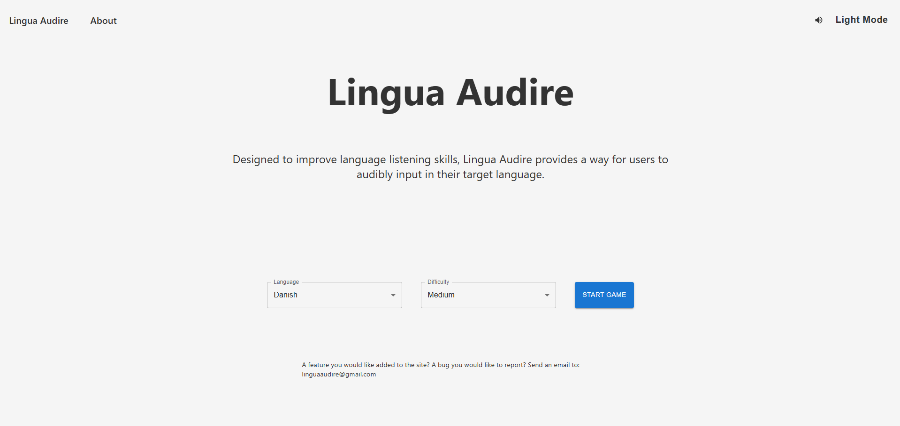
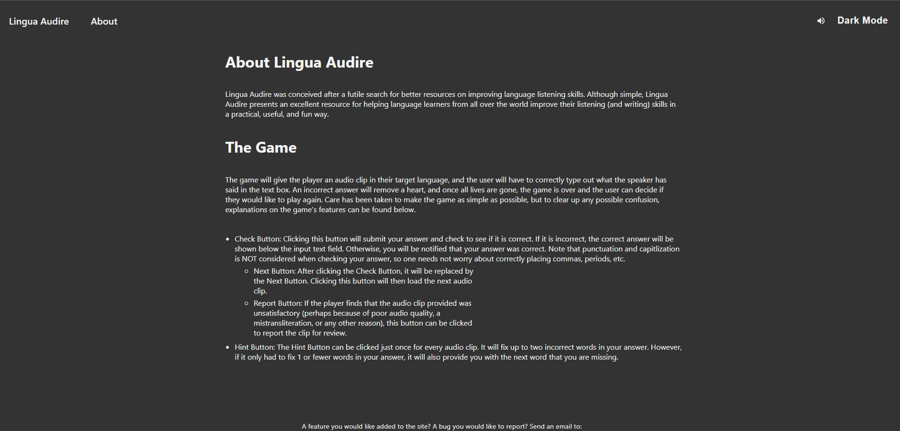
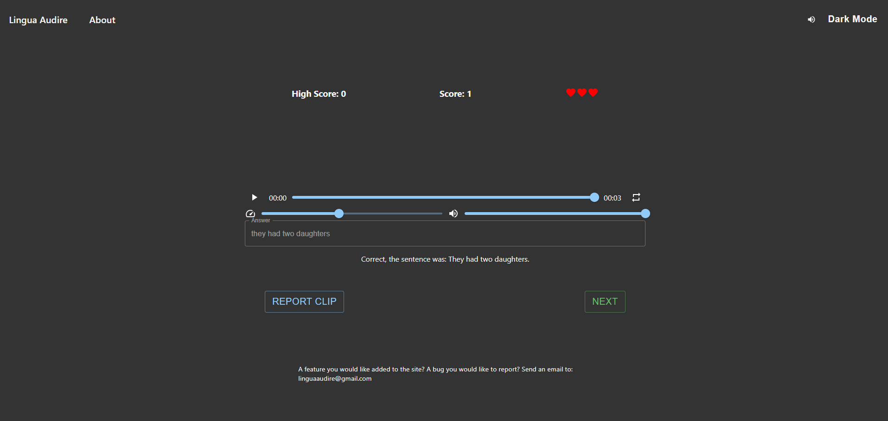

# Lingua Audire
A site designed to help users improve their language listening skills by having them transcribe spoken sentences in their target language.

## Sceenshots






## Docker
Lingua Audire makes use of containerization with docker, making testing and deployment of the site a breeze.

### With Docker Compose
For starting the app:

```docker-compose up```

For building the app:

```docker-compose build```

For shutting the app down:

```docker-compose down -v```

### Building Individually
For the Lingua Audire web server:

```docker build --tag linguaaudire .```

### Running Individually
For the mySQL database:

```docker run --name lingua-mysql -p 3306:3306 -e MYSQL_ROOT_PASSWORD=replace-with-password -d mysql```

For the Lingua Audire web server:

```docker run -p 8080:8080 linguaaudire```